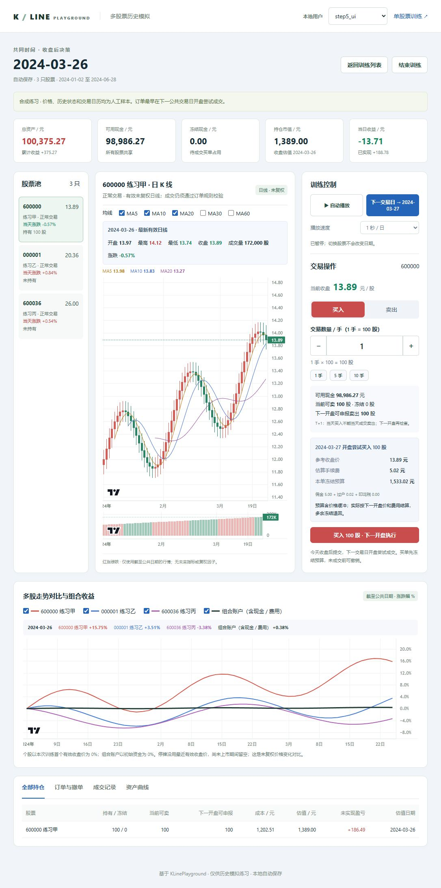
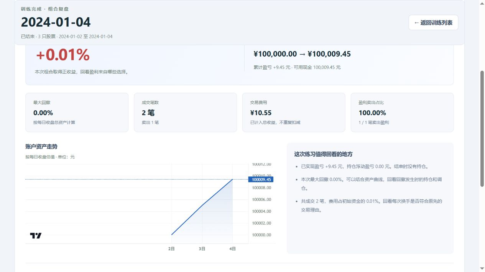

# KLinePlayground · A 股组合复盘训练

在同一个历史日期，用一份资金管理多只股票，练习选股、仓位分配和调仓，再通过收益曲线与交易记录复盘自己的决策。

**[下载 Windows 版](https://github.com/tryna26/KLinePlayground/releases/tag/v4.0.0-rc.2) · [第一次使用](docs/USER_GUIDE.md) · [版本更新](release_notes_v4.0.0-rc.2.md)**



## 重点功能

- **自由组合与随机盲盒**：选择 1–20 只 A 股、日期区间和初始资金，或按板块、数量与训练时长随机抽取组合；同时保留单股票训练。
- **一份账户，多股联动**：所有股票共享现金与公共交易日期，切换股票只切换视图；持仓总股数、可卖股数和委托冻结数量清楚显示。
- **K 线与组合一起看**：单股日 K、成交量、悬停行情和 MA 均线；切换多股对比，观察个股走势与账户收益。训练中图表仅展示已走到的日期。
- **完整的委托操作**：收盘后提交，下一交易日开盘尝试成交；支持 T+1、资金与股份冻结、撤单及撤单后修改。同股、同方向、同执行日期的待成交委托汇总展示，展开后逐笔操作。
- **自动推进与进度保存**：手动或自动播放公共交易日，每次操作自动保存；关闭后继续原进度，也可以确认后重置本局，从原股票和起始日期重新练习。
- **结束后有复盘**：收益率、资产曲线、最大回撤、成交与费用、各股盈亏贡献；交易明细和完整训练区间可回看，历史总结单独保留在训练列表。



## 下载与开始

当前版本为 **4.0.0-rc.2**，提供 Windows 10/11 x64 安装包和便携 ZIP，均需要 Microsoft Edge WebView2 Runtime。

1. 从 [GitHub Releases](https://github.com/tryna26/KLinePlayground/releases/tag/v4.0.0-rc.2) 下载，按同页 `SHA256SUMS.txt` 校验文件。候选包尚未做代码签名。
2. 安装后启动；便携版解压后运行 `KLinePlayground/bin/KLinePlayground.exe`。
3. 创建本地用户，点击“新建训练”，选择单股票或组合训练，再选指定模式或随机盲盒。
4. 组合指定模式输入股票、日期和资金后直接开始，系统自动加载行情，无需先准备三只固定股票的数据。

详细操作见[新手指南](docs/USER_GUIDE.md)。数据或启动遇到问题，见[故障排查](docs/TROUBLESHOOTING.md)。

## 训练方式

组合训练表示“截至公共日期收盘后作决策”。提交委托先占用预算或股份，推进到下一交易日后再按开盘价和规则检查成交。下单区可直接查看待成交委托，撤单后释放占用；修改需要重新提交。

指定模式支持与单股训练共用的在线日线和本地离线数据，起止日期遇到非交易日会对齐区间内交易日。随机盲盒需要所选股票具有共同可用的行情区间。在线数据依赖提供方服务；下载失败时可更换数据源或补充离线数据。

这是**历史日线简化模拟**：无法还原盘中盘口、排队、部分成交或盘中禁撤时段。自由组合使用未复权行情和固定模拟费率，不计分红送转，不用于精确历史收益回测或实盘交易。旧版已核验训练恢复后继续使用保存时的快照与规则。

## 源码运行

使用 Python **3.13.17**，在项目根目录执行：

```powershell
py -3.13 -m venv .venv
.\.venv\Scripts\python.exe -m pip install -r requirements.txt
.\.venv\Scripts\python.exe run_dev.py
```

打开 <http://127.0.0.1:5050>。桌面窗口使用 `python run_dev.py --desktop`。开发数据默认写入 `.runtime/data` 和 `.runtime/users`，可通过 `--home`、`--data-dir`、`--users-dir` 指定；安装包和源码均不附用户记录、真实行情库或 API 凭据。

开发与测试见 [DEVELOPMENT.md](docs/DEVELOPMENT.md)，Windows 构建见 [BUILD_GUIDE.md](BUILD_GUIDE.md)，组合接口见 [PORTFOLIO_API.md](docs/PORTFOLIO_API.md)。

## 来源与许可

本项目由 tryna26 基于 [fat7/KLinePlayground v3.2](https://github.com/fat7/KLinePlayground) 二次开发，重点扩展多股票组合训练与复盘。保留原作者版权，沿用 [MIT 许可](LICENSE)；依赖声明见 [THIRD_PARTY_NOTICES.md](THIRD_PARTY_NOTICES.md)。
